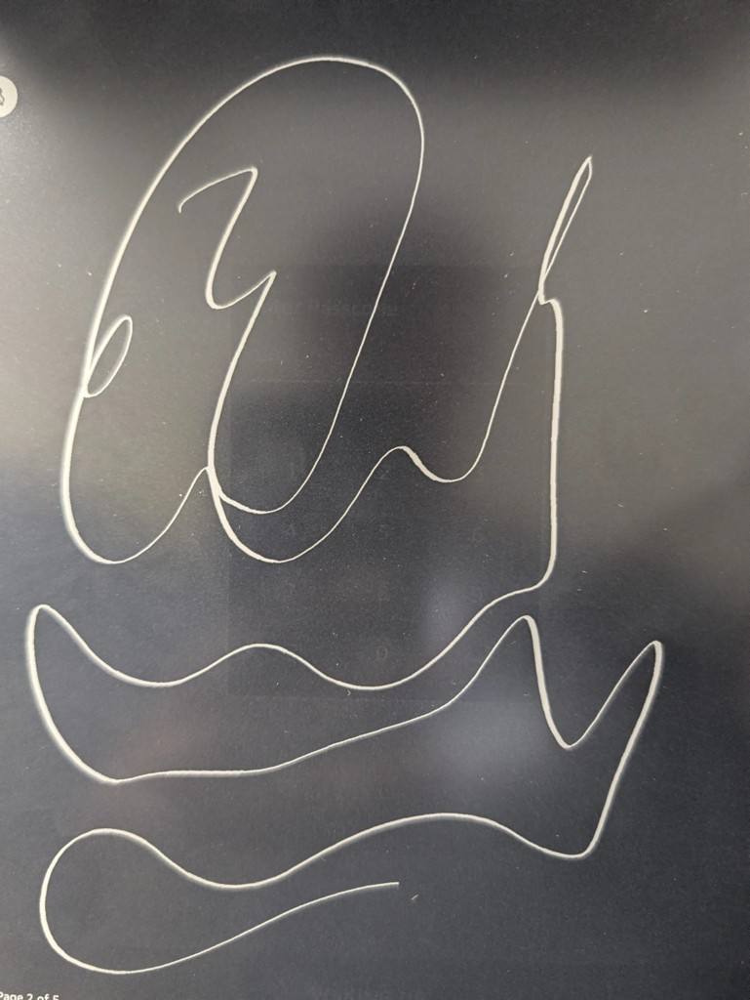
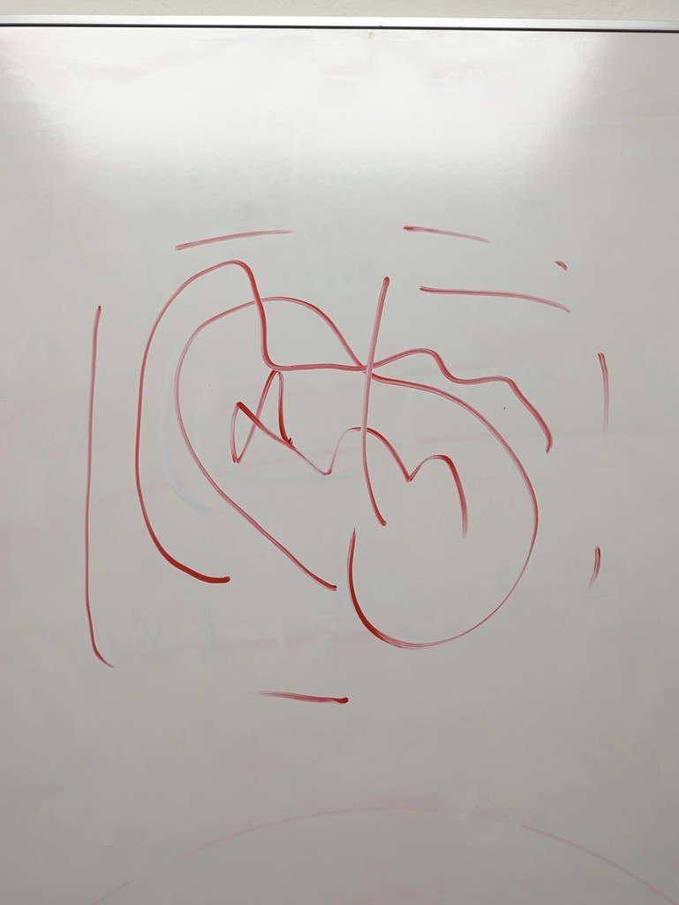
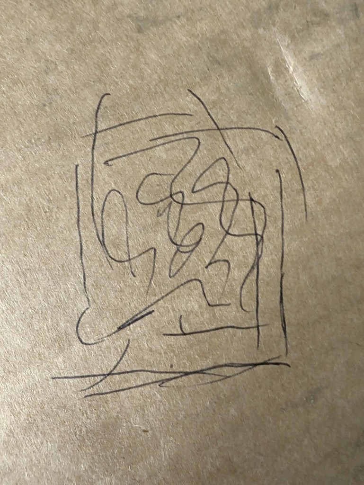
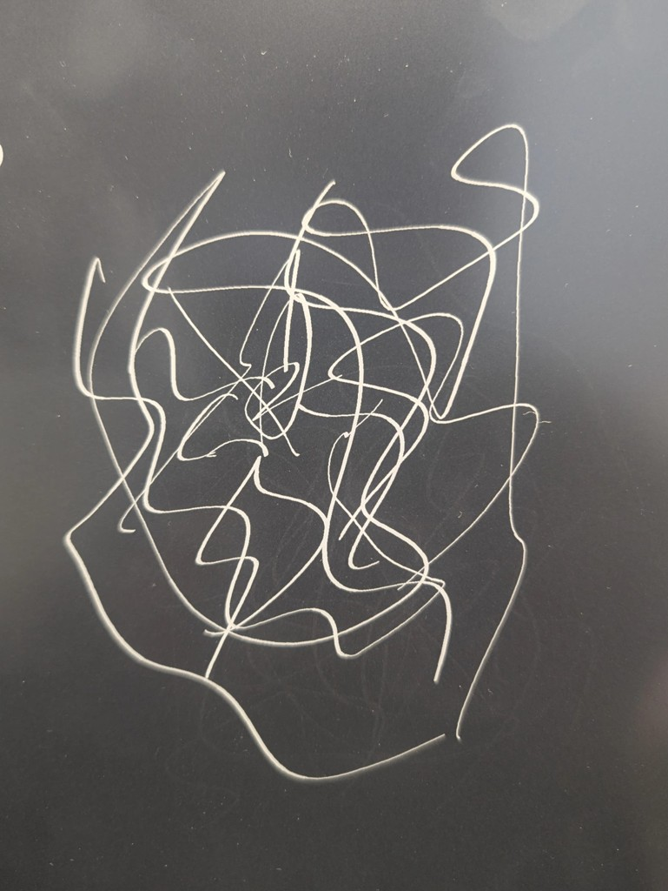
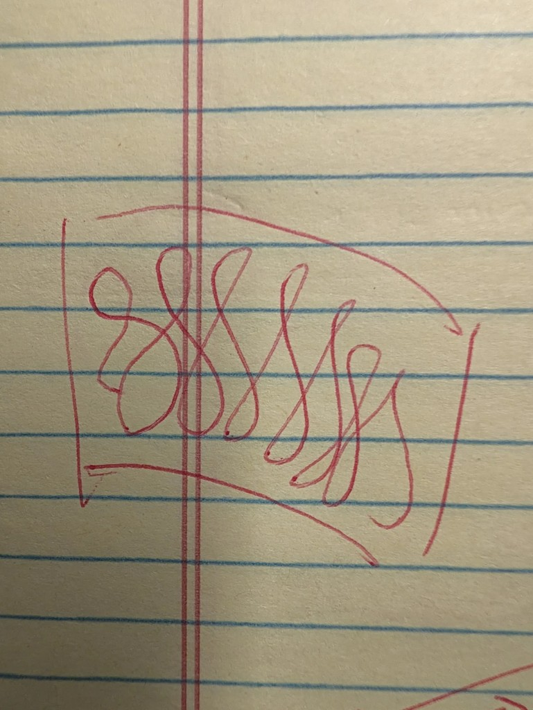
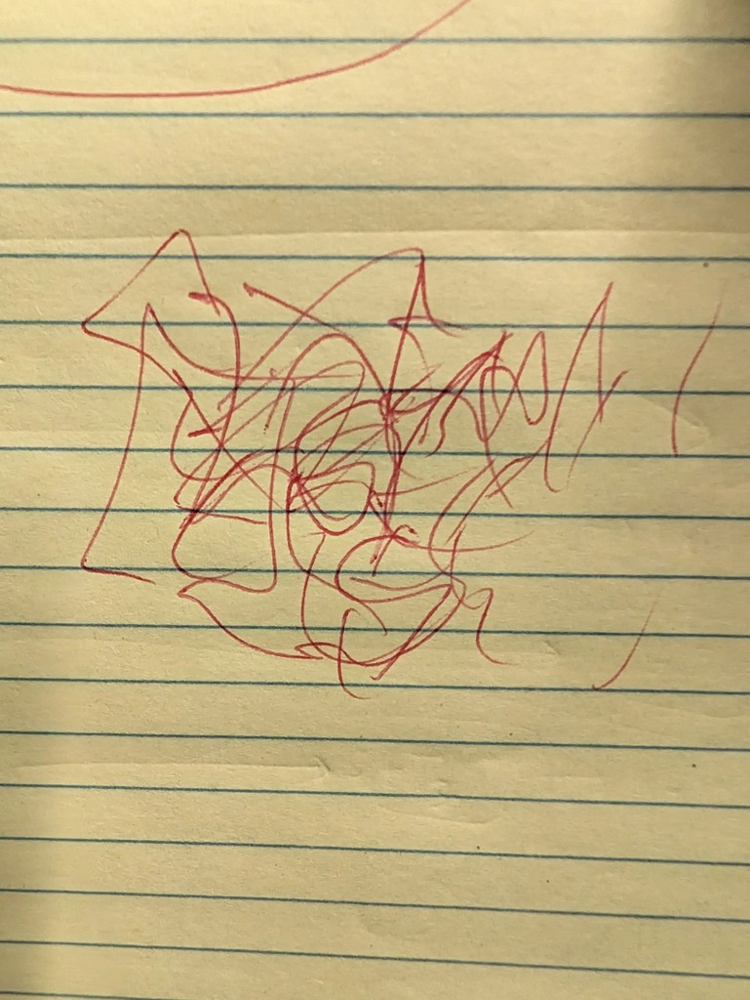
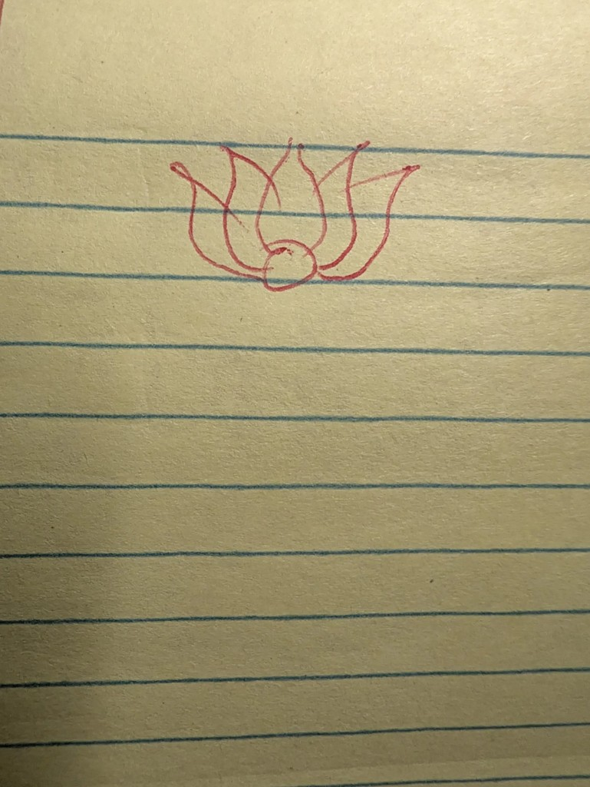
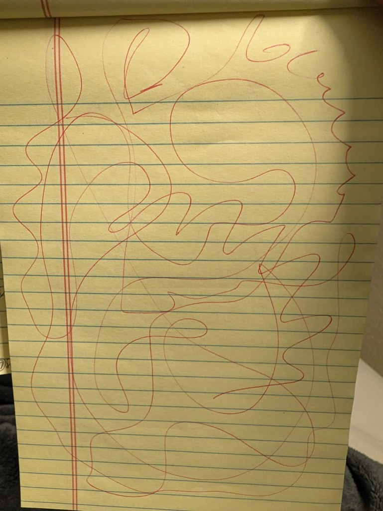
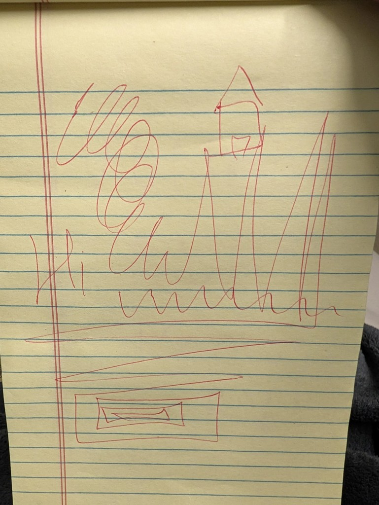

# Golden dataset: eval

9 labelled photos. Each shows what a person expected and what the live API returned. Regenerate with `python benchmark/eval_golden.py`.

## golden_eval_001 · FAIL

**Shows:** Smooth flowing loops and waves, drawn on an e-ink writing tablet

| Expected | Actual |
|---|---|
| <pre>{
 "safety_status": "SAFE",
 "primary_emotion_class": "Calm Flow"
}</pre> | <pre>{
 "safety_status": "BLOCKED_CONTENT",
 "primary_emotion_class": null,
 "merged_scores": null
}</pre> |

**A good reading should:** Notices the long unbroken curves and steady rhythm

> This looks like something other than a sketch—try photographing your paper drawing.

## golden_eval_002 · PASS

**Shows:** Red whiteboard marker: a tangled knot of crossing loops, ringed by short broken strokes

| Expected | Actual |
|---|---|
| <pre>{
 "safety_status": "SAFE",
 "primary_emotion_class": "Anxiety (or Stress)"
}</pre> | <pre>{
 "safety_status": "SAFE",
 "primary_emotion_class": "Anxiety",
 "merged_scores": {
  "stress": 0.42,
  "anxiety": 0.55,
  "mental_fatigue": 0.28,
  "calm_flow": 0.45,
  "radiant_joy": 0.25
 }
}</pre> |

**A good reading should:** Notices the knotted centre and the fragmented strokes around it

> There is an interesting conversation happening in your lines between a desire for open movement and a quiet need to hold everything together. On the inside, your hand moved through sharp peaks and restless waves, with a single vertical stroke cutting right through the center as if trying to pause or anchor a busy train of thought. Around those sharper movements, though, you drew wide, sweeping curves and a loose frame of dashes along the edges. You are not boxed in tightly; there are plenty of gaps and breathing room around the border. It looks like your mind may be navigating some inner friction or scattered energy right now, while another part of you is gently trying to wrap around it, contain it, and give it space to settle.

## golden_eval_003 · PASS

**Shows:** Black pen on brown kraft paper: tight squiggles boxed in by a frame, heavy lines underneath

| Expected | Actual |
|---|---|
| <pre>{
 "safety_status": "SAFE",
 "primary_emotion_class": "Anxiety (or Stress)"
}</pre> | <pre>{
 "safety_status": "SAFE",
 "primary_emotion_class": "Anxiety",
 "merged_scores": {
  "stress": 0.55,
  "anxiety": 0.62,
  "mental_fatigue": 0.25,
  "calm_flow": 0.28,
  "radiant_joy": 0.15
 }
}</pre> |

**A good reading should:** Notices the enclosed, constricted squiggles and the grounding lines below

> There is a striking contrast here between a firm outer frame and a very busy interior. Your hand built a clear, reinforced boundary around the edges, almost like a container or a quiet wall, while the space inside is filled with winding, back-and-forth movement that loops and doubles back on itself. It feels as though you may be carrying a lot of active, circling thoughts right now while working hard to keep everything held neatly in place. Even within that tight space, your lines remain steady and present, showing a mind that is engaged and trying to organize or contain a swirl of restless energy.

## golden_eval_004 · FAIL

**Shows:** E-ink tablet: dense tangle of crossing lines filling the middle

| Expected | Actual |
|---|---|
| <pre>{
 "safety_status": "SAFE",
 "primary_emotion_class": "Stress (or Anxiety)"
}</pre> | <pre>{
 "safety_status": "RETRY_CAPTURE",
 "primary_emotion_class": null,
 "merged_scores": null
}</pre> |

**A good reading should:** Notices the density and overlapping strokes

> We couldn't find your lines yet—could you move a little closer to your sketch?

## golden_eval_005 · PASS

**Shows:** Red pen on legal pad: a row of repeating loops inside bracket-like curves

| Expected | Actual |
|---|---|
| <pre>{
 "safety_status": "SAFE",
 "primary_emotion_class": "Calm Flow (or Radiant Joy)"
}</pre> | <pre>{
 "safety_status": "SAFE",
 "primary_emotion_class": "Calm Flow",
 "merged_scores": {
  "stress": 0.25,
  "anxiety": 0.18,
  "mental_fatigue": 0.28,
  "calm_flow": 0.68,
  "radiant_joy": 0.32
 }
}</pre> |

**A good reading should:** Notices the rhythmic, repeated loops

> There is a steady, soothing rhythm in these repeating figure-eight loops, moving gently from side to side like a slow breath or a quiet pacing of thought. At the same time, the four-sided frame drawn around them suggests a desire to hold that movement inside clear edges, keeping your focus contained and safe rather than letting it drift too far. Notice how the loops begin wide and open on the left, then gradually narrow and tilt downward as they reach the right side—a subtle sign that while you are seeking steadiness and flow, your energy may be tapering off slightly or tightening under a quiet wish to keep everything neatly in place.

## golden_eval_006 · PASS

**Shows:** Red pen on legal pad: dense jagged scribble with sharp angles

| Expected | Actual |
|---|---|
| <pre>{
 "safety_status": "SAFE",
 "primary_emotion_class": "Stress (or Anxiety)"
}</pre> | <pre>{
 "safety_status": "SAFE",
 "primary_emotion_class": "Anxiety",
 "merged_scores": {
  "stress": 0.65,
  "anxiety": 0.78,
  "mental_fatigue": 0.35,
  "calm_flow": 0.22,
  "radiant_joy": 0.15
 }
}</pre> |

**A good reading should:** Notices the heavy overlapping and sharp turns

> There is a lot of restless, crisscrossing energy held in a fairly tight space here. Your lines move quickly between sharp, sudden turns and tangled loops, as if several thoughts or feelings were arriving at once and colliding before any single one could finish. At the same time, there are moments where the pen lifts and softens into lighter, detached marks toward the edges, suggesting an impulse to step back or catch your breath amid the noise. Right now your inner state feels active, crowded, and slightly on edge—like a mind working overtime to sort through overlapping threads, yet still leaving small pockets of breathing room around the perimeter.

## golden_eval_007 · PASS

**Shows:** Small lotus flower drawn near the top of a legal pad page

| Expected | Actual |
|---|---|
| <pre>{
 "safety_status": "SAFE",
 "primary_emotion_class": "Calm Flow (or Radiant Joy)"
}</pre> | <pre>{
 "safety_status": "SAFE",
 "primary_emotion_class": "Calm Flow",
 "merged_scores": {
  "stress": 0.15,
  "anxiety": 0.15,
  "mental_fatigue": 0.25,
  "calm_flow": 0.78,
  "radiant_joy": 0.45
 }
}</pre> |

**A good reading should:** Notices the symmetry and the open petals

> There is a quiet steadiness in how you moved your pen across the page. Choosing a gentle, unfolding lotus form suggests a mind seeking centeredness and calm, holding onto balance even in a brief fifteen-second window. The strokes are unhurried and rhythmic, curving upward and outward from a single grounded point, which points to a composed inner state—perhaps a bit contained or conserving energy, given the small, neat space the drawing occupies, yet clear and intentional. You seem to be meeting this moment with softness, patience, and a desire for stillness.

## golden_eval_008 · PASS

**Shows:** Big looping curves filling the whole legal pad page

| Expected | Actual |
|---|---|
| <pre>{
 "safety_status": "SAFE",
 "primary_emotion_class": "Radiant Joy (or Calm Flow)"
}</pre> | <pre>{
 "safety_status": "SAFE",
 "primary_emotion_class": "Calm Flow",
 "merged_scores": {
  "stress": 0.25,
  "anxiety": 0.35,
  "mental_fatigue": 0.15,
  "calm_flow": 0.55,
  "radiant_joy": 0.55
 }
}</pre> |

**A good reading should:** Notices how far the lines travel and the wide coverage

> Your lines move across the whole page with an open, restless momentum, like a mind that is wide awake and wandering through several thoughts at once. You begin with generous, sweeping loops that take up plenty of space, suggesting a willingness to let go and move freely without holding yourself back. At the same time, those smooth curves periodically shift into quick, scalloped waves and sharper zig-zags along the edges and center, pointing to little bursts of tension or mental chatter tucked inside an otherwise fluid state. Overall, there is a sense of active release here—your energy feels mobile and searching rather than stuck, finding balance between gentle flow and lively movement.

## golden_eval_009 · PASS

**Shows:** Tower, tall zigzags, nested boxes and loops, with 'Hi' written small

| Expected | Actual |
|---|---|
| <pre>{
 "safety_status": "SAFE",
 "primary_emotion_class": "Anxiety (or Stress)"
}</pre> | <pre>{
 "safety_status": "SAFE",
 "primary_emotion_class": "Anxiety",
 "merged_scores": {
  "stress": 0.48,
  "anxiety": 0.58,
  "mental_fatigue": 0.18,
  "calm_flow": 0.38,
  "radiant_joy": 0.42
 }
}</pre> |

**A good reading should:** Reads the drawing; treats 'Hi' as a stray word, not a message

> There is a lively mix of energies moving across this page, almost like several distinct moods meeting in one quick breath. On the left, those loose, spiraling loops carry an open, playful momentum, as if your hand wanted to warm up and let something swirl freely. Moving to the right, the rhythm shifts into tall, sharp peaks that rise high and drop fast, giving a sense of heightened alertness or restless energy looking for somewhere to go. Perched right at the top of those steep ridges is a small, simple house, which feels like a quiet anchor or a desire for shelter and steadiness above the noise. Beneath all that movement, the wide back-and-forth strokes settle into nested rectangles at the very bottom, suggesting an instinct to gather everything back in, draw a clear boundary, and ground yourself.

